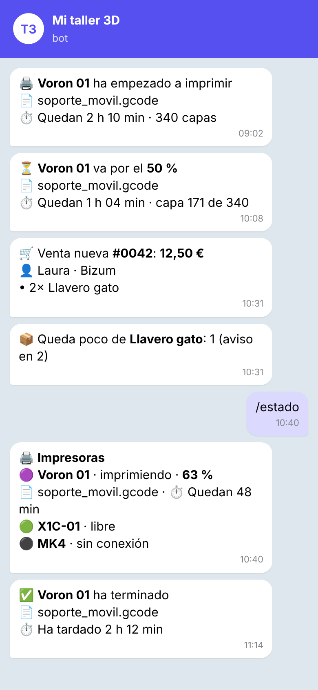
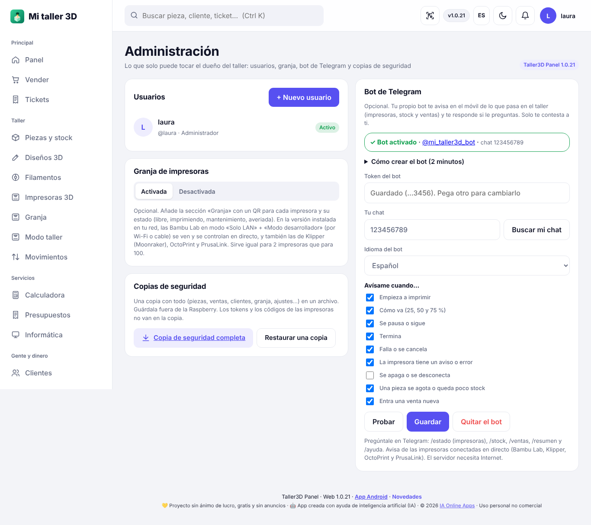
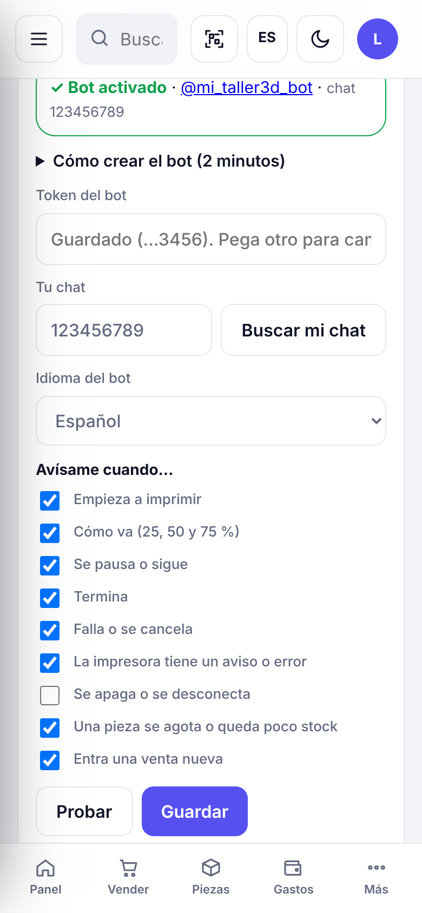

# Bot de Telegram del taller

*[English below](#telegram-bot-english)*

Taller3D Panel puede tener **su propio bot de Telegram**. Es opcional y gratis. Una vez puesto:

- **Te avisa solo** en el móvil cuando una impresora **empieza**, va por el **25, 50 y 75 %**, se
  **pausa**, **termina**, **falla** o tiene un **aviso**; cuando una pieza **se agota** o le queda poco
  stock, y cuando **entra una venta**.
- **Te responde** si le preguntas: `/estado`, `/stock`, `/poco`, `/ventas`, `/resumen` y `/ayuda`.
- **Solo te habla a ti.** Contesta únicamente al chat que guardas en la app. Si otra persona encuentra
  tu bot y le escribe, no le cuenta nada.

No hay que instalar nada más: el bot va **dentro del mismo servidor** de Taller3D Panel (la Raspberry
Pi o el PC). Solo hace falta que ese equipo tenga Internet.

---

## 1. Crear el bot en Telegram (2 minutos)

1. En Telegram, busca **@BotFather** (el oficial, con la marca azul) y ábrelo.
2. Escríbele **`/newbot`**.
3. Te pide un **nombre**: el que verás arriba del chat. Por ejemplo `Mi taller 3D`.
4. Te pide un **usuario** que acabe en `bot`. Por ejemplo `mi_taller3d_bot` (si está cogido, prueba
   otro).
5. BotFather te da un **token**, algo como `123456789:AAH…`. Es la llave de tu bot: **no la compartas
   con nadie** ni la pegues en chats o en GitHub.
6. Abre tu bot nuevo (toca el enlace `t.me/…` que te da BotFather), pulsa **Iniciar** y escríbele
   `hola`. Así la app podrá encontrar tu chat sola.

> **Usa un bot solo para el taller.** Si el mismo bot lo usa otro programa a la vez (otro panel, un
> bot de la Pi 5…), Telegram solo deja que uno lea los mensajes y el bot no contestará bien.

## 2. Ponerlo en Taller3D Panel

Entra como **administrador** y ve a **Administración → Bot de Telegram** (en el menú de la izquierda;
en el móvil, en **Más**).

1. Pega el **token** en «Token del bot».
2. Pulsa **Buscar mi chat**. Se rellena tu número de chat (el de la conversación donde escribiste
   `hola`). Si no sale, vuelve a escribir `hola` al bot y pulsa otra vez.
3. Elige el **idioma del bot** (español o inglés) y **qué avisos quieres**.
4. Pulsa **Probar**. Te tiene que llegar un mensaje «¡Funciona!».
5. Pulsa **Guardar**. Arriba sale **✓ Bot activado** con el nombre de tu bot.

Para dejar de usarlo, pulsa **Quitar el bot**. Para cambiar de bot, pega el token nuevo y guarda.

**¿Y si quiero los avisos en un grupo?** Crea el grupo, añade el bot, escribe algo en el grupo y pulsa
«Buscar mi chat»: saldrá el número del grupo (empieza por `-`). En el grupo, el bot contesta las órdenes
a cualquiera que esté en él.

## 3. Qué te manda el bot

| Cuándo | Mensaje (ejemplo) |
|---|---|
| Empieza una impresión | 🖨️ **Voron 01** ha empezado a imprimir · 📄 soporte_movil.gcode · ⏱️ Quedan 2 h 10 min · 340 capas |
| Va por el 25, 50 y 75 % | ⏳ **Voron 01** va por el **50 %** · ⏱️ Quedan 1 h 04 min · capa 171 de 340 |
| Se pausa / sigue | ⏸️ **X1C-01** está en pausa (63 %) · ▶️ **X1C-01** sigue imprimiendo |
| Termina | ✅ **Voron 01** ha terminado · ⏱️ Ha tardado 2 h 12 min |
| Falla o se cancela | ❌ **MK4**: la impresión ha fallado o se ha cancelado · al 37 % |
| La impresora tiene un aviso | ⚠️ **X1C-01** tiene un aviso. Míralo en su pantalla. |
| Se apaga o se desconecta (apagado por defecto) | 🔌 **MK4** se ha apagado o no responde |
| Una pieza se agota o baja del mínimo | 📦 Queda poco de **Llavero gato**: 1 (aviso en 2) · 📦 **Llavero gato** se ha agotado |
| Entra una venta | 🛒 Venta nueva **#0042**: **12,50 €** · 👤 Laura · Bizum · • 2× Llavero gato |

Los avisos de impresoras salen de las que están **conectadas en directo** en la Granja. Las que llevas
a mano (estado «libre», «imprimiendo»… que marcas tú) salen en `/estado` pero no mandan avisos solas.

## 4. Lo que le puedes preguntar

| Orden | Qué responde |
|---|---|
| `/estado` | Todas las impresoras: imprimiendo (con % y tiempo que queda), libre, en pausa, sin conexión… |
| `/stock` | Todo tu stock: cada pieza que te queda con sus unidades (y aparte las agotadas) |
| `/poco` | Solo las piezas agotadas o por debajo de su mínimo (sin las marcadas «No la voy a reponer») |
| `/ventas` | Ventas de hoy y del mes, lo que te deben y la última venta |
| `/resumen` | Todo lo anterior junto |
| `/ayuda` | Lo que sabe hacer |

También entiende las órdenes en inglés (`/status`, `/sales`, `/summary`, `/help`). Al guardar el bot,
la app le pone el **menú de órdenes** para que salgan al escribir `/`.

## 5. Impresoras que avisan

| Tipo | Cómo se conecta | Qué hace falta |
|---|---|---|
| **Bambu Lab** (X1, P1, P2S, A1, H2…) en modo LAN | MQTT en la red de casa | «Solo LAN» + «Modo desarrollador», IP, nº de serie y código de acceso ([GRANJA.md](GRANJA.md)) |
| **Bambu Lab** por la nube | Nube de Bambu (solo ver) | Tu cuenta de Bambu en «☁ Nube Bambu» |
| **Klipper** con Moonraker (Mainsail / Fluidd): Voron, Creality K1/K2, Qidi, Sovol, Elegoo Neptune 4… | HTTP, puerto 7125 | La IP. La clave API solo si la activaste en Moonraker |
| **OctoPrint** (OctoPi) | HTTP | La IP y una clave API (OctoPrint → Ajustes → Application Keys) |
| **PrusaLink** (MK4/MK4S, MK3.9, XL, MINI+, CORE One) | HTTP | La IP, el usuario `maker` y la contraseña (en la impresora: Ajustes → Red → PrusaLink) |

Se añaden en **Granja → Añadir impresora → Conexión**. Las de Klipper, OctoPrint y PrusaLink también se
pueden **pausar, seguir y parar** desde la app.

## 6. Seguridad

- El token y las claves de las impresoras se guardan **solo en tu servidor** (en la base de datos de
  la carpeta de datos). **Nunca** se mandan al navegador ni van en las copias de seguridad.
- Solo el **administrador** ve y cambia la sección del bot.
- El bot solo contesta al chat guardado. A cualquier otro chat no le cuenta nada.
- Si crees que alguien tiene tu token, en BotFather escribe `/revoke`, elige tu bot y pega el token
  nuevo en la app.

## 7. Si algo no va

| Lo que pasa | Qué hacer |
|---|---|
| «Telegram no reconoce ese token» | Cópialo otra vez entero de BotFather (con el número, los dos puntos y todo lo de después). |
| «No encuentro tu chat» | Abre tu bot, pulsa **Iniciar**, escríbele `hola` y vuelve a pulsar «Buscar mi chat». |
| «No se ha podido conectar con Telegram» | El servidor no tiene Internet o un cortafuegos bloquea `api.telegram.org`. |
| «Este bot ya lo está usando otro programa» | El mismo bot está puesto en otro sitio. Crea un bot nuevo solo para el taller. |
| No llegan avisos de una impresora | Mira en la Granja que salga **en directo** (con su % y temperaturas). Si pone «sin conexión», revisa la IP y la clave. |
| Quiero menos mensajes | Quita los avisos que no quieras en **Avísame cuando…** y pulsa Guardar. |

---

## Telegram bot (English)

Taller3D Panel can have **its own Telegram bot**. It is optional and free. Once set up:

- **It alerts you** on your phone when a printer **starts**, reaches **25, 50 and 75 %**, **pauses**,
  **finishes**, **fails** or shows a **warning**; when a part **runs out** or runs low; and when **a
  sale comes in**.
- **It answers** when you ask: `/status`, `/stock`, `/low`, `/sales`, `/summary` and `/help` (the Spanish
  commands work too).
- **It only talks to you.** It only answers the chat saved in the app.

Nothing else to install: the bot runs **inside the Taller3D Panel server** (Raspberry Pi or PC). The
server just needs Internet access.

### 1. Create the bot (2 minutes)

1. In Telegram, search for **@BotFather** (the official one, blue tick) and open it.
2. Send **`/newbot`**, choose a **name** (e.g. `My 3D workshop`) and a **username** ending in `bot`
   (e.g. `my_workshop3d_bot`).
3. BotFather gives you a **token** like `123456789:AAH…`. Keep it secret.
4. Open your new bot, press **Start** and send it `hello`.

Use a bot **only for the workshop**: if another program uses the same bot, it will not answer properly.

### 2. Add it to Taller3D Panel

Sign in as **administrator** and go to **Administration → Telegram bot**:

1. Paste the **token**.
2. Press **Find my chat** (your chat number is filled in).
3. Choose the bot **language** and **which alerts** you want.
4. Press **Test** (you get a “It works!” message) and then **Save**.

For a group, add the bot to the group, write something there and press **Find my chat**: the group
number (starting with `-`) appears.

### 3. Alerts and commands

| Alert | Example |
|---|---|
| Print starts | 🖨️ **Voron 01** has started printing · ⏱️ 2 h 10 min left |
| 25 / 50 / 75 % | ⏳ **Voron 01** is at **50 %** · layer 171 of 340 |
| Paused / resumed | ⏸️ **X1C-01** is paused (63 %) |
| Finished | ✅ **Voron 01** has finished · ⏱️ It took 2 h 12 min |
| Failed or cancelled | ❌ **MK4**: the print failed or was cancelled |
| Printer warning | ⚠️ **X1C-01** has a warning. Check its screen. |
| Off / disconnected (off by default) | 🔌 **MK4** is off or not responding |
| Low or no stock | 📦 **Keyring cat** is running low: 1 (warning at 2) |
| New sale | 🛒 New sale **#0042**: **€12.50** |

| Command | Answer |
|---|---|
| `/status` | Every printer: printing (with % and time left), idle, paused, offline… |
| `/stock` | All your stock: every part you have left with its units (and the out-of-stock ones apart) |
| `/low` | Only parts out of stock or below their minimum (except those marked «I won't restock it») |
| `/sales` | Sales today and this month, unpaid amount and the last sale |
| `/summary` | All of the above |

### 4. Supported printers

Bambu Lab (LAN mode or cloud, view only), **Klipper/Moonraker** (Mainsail, Fluidd: Voron, Creality
K1/K2, Qidi, Sovol, Elegoo Neptune 4…), **OctoPrint** (API key) and **PrusaLink** (MK4, MK3.9, XL,
MINI+, CORE One: user `maker` + password). Add them in **Farm → Add printer → Connection**. Klipper,
OctoPrint and PrusaLink printers can also be paused, resumed and stopped from the app.

### 5. Security

The token and printer keys are stored **only on your server**; they are never sent to the browser
and are not part of backups. Only the administrator can see the bot section. If your token leaks,
send `/revoke` to BotFather and paste the new token in the app.
